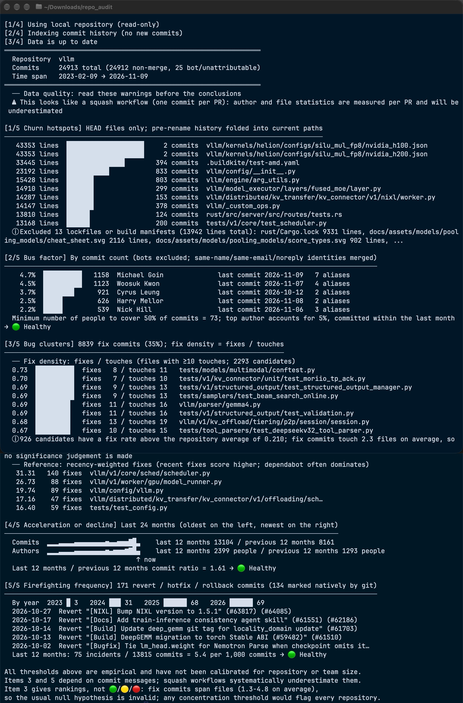

 

# repo-audit

A Git repository health-check tool. Given a repository (URL / `owner/repo` / local path), it automatically makes a bare clone, scans the history once,
and reports five audit findings: **change hotspots, bus factor, bug clustering, team trends, and firefighting frequency**, with 🟢/🟡/🔴 assessments where applicable.

For agent development rules and design constraints, see [`CLAUDE.md`](CLAUDE.md).

---

## Quick start

From the project root, build the release binary (a single statically linked file with SQLite built in and no system-library dependency):

```bash
cargo build --release
```

The binary is at `target/release/repo-audit`. You can link it into your PATH for global use, but this is not required.

Audit a repository:

```bash
./target/release/repo-audit audit <REPO> --tmp-dir <STAGING>
```

`audit` is the default command and may be omitted.

**Remote repositories require `--tmp-dir <DIR>` whenever a fresh clone is needed**: a staging
directory on the same volume as the cache, with no fallback. Local paths never need it.
`<STAGING>` in the examples below stands for such a directory; once the cache exists the flag can
be omitted.

---

## Four supported `<REPO>` formats

All four forms below are recognized automatically:

```bash
./target/release/repo-audit audit <owner>/<repo> --tmp-dir <STAGING>
```

```bash
./target/release/repo-audit audit https://<host>/<owner>/<repo> --tmp-dir <STAGING>
```

```bash
./target/release/repo-audit audit git@<host>:<owner>/<repo>.git --tmp-dir <STAGING>
```

```bash
./target/release/repo-audit audit <PATH-TO-LOCAL-REPO>
```

Note: **only the `owner/repo` shorthand is treated as GitHub**; other hosts require a full URL or scp-style address.

**Remote repositories** are bare-cloned to `~/Library/Caches/repo-audit/<host>/<owner>/<repo>.git`,
with an `.audit.db` index in the same directory. Subsequent runs are incremental and fetch only new commits.

**Local paths** access the original Git directory read-only (via `rev-parse --absolute-git-dir`), without copying the bare repository or making network requests.
Absolute paths and paths beginning with `./`, `../`, or `~` are recognized as paths; a relative path is treated as a path only if it is itself a Git repository.

The tool only makes bare clones: **it never checks out code, fetches submodules, or runs anything from the repository**.
The audited repository is untrusted input, and every Git call enforces safety options (disabling hooks, `file://` redirects, external diff drivers, and so on).

---

## Common variants

The remote examples below include `--tmp-dir` because a fresh clone needs it; once the cache
exists, the flag can be omitted.

Output JSON for consumption by other tools:

```bash
./target/release/repo-audit audit <REPO> --tmp-dir <STAGING> --json
```

Audit a specific branch or tag (default: `HEAD`):

```bash
./target/release/repo-audit audit <REPO> --tmp-dir <STAGING> --ref <BRANCH-OR-TAG>
```

Inspect author identity merges (`--all` also lists authors who were not merged).
Use this if you suspect that identity merging has combined different people or split one person into several:

```bash
./target/release/repo-audit identities <REPO> --tmp-dir <STAGING> --all
```

Fetch and build the index without producing a report. Useful for warming indexes for a batch of repositories:

```bash
./target/release/repo-audit index <REPO> --tmp-dir <STAGING>
```

Discard the cache and rebuild the index from the cloned history:

```bash
./target/release/repo-audit audit <REPO> --tmp-dir <STAGING> --reindex
```

Do not merge authors by matching names; this is more conservative than the default:

```bash
./target/release/repo-audit audit <REPO> --tmp-dir <STAGING> --no-name-merge
```

Increase the clone/fetch timeout for large repositories on slow networks (default: 1800 seconds):

```bash
./target/release/repo-audit audit <REPO> --tmp-dir <STAGING> --timeout 3600
```

Self-test (touches no real repository; creates fixtures with real Git in a temporary directory and runs 28 end-to-end assertions):

```bash
./target/release/repo-audit selftest
```

---

## Complete options

The three subcommands (`audit` / `index` / `identities`) share the same options:

| Option | Description |
|---|---|
| `--ref <REF>` | Branch or commit to analyze; default `HEAD` |
| `--reindex` | Discard the cached index and rebuild it |
| `--no-name-merge` | Do not merge authors by matching names (more conservative) |
| `--bot-pattern <REGEX>` | Additional bot-detection regex; repeatable |
| `--mailmap <FILE>` | Additional mailmap file; defaults to `~/.config/repo-audit/mailmap` |
| `--cache-dir <DIR>` | Cache root; defaults to `~/Library/Caches/repo-audit` on macOS |
| `--tmp-dir <DIR>` | Staging directory for `clone --bare` (required for remote repositories): it must be on the same volume as the cache; unwritable or cross-volume staging fails immediately |
| `--timeout <TIMEOUT>` | Clone/fetch timeout in seconds; default `1800` |
| `-q, --quiet` | Suppress progress lines |
| `--json` | Output JSON |
| `--all` | `identities` only: include authors who were not merged |

The `REPO_AUDIT_CACHE` environment variable can provide the default cache directory.

---

## Authentication and timeouts

**Private repositories do not require a token in the command.** The tool reuses the system Git credential helper / `gh auth`;
userinfo in URLs is discarded, so credentials enter neither the program nor the cache.

`GIT_TERMINAL_PROMPT=0` is enforced, so the tool **will not hang at the terminal waiting for a password**; authentication failures produce an immediate error.
If authentication fails, run `gh auth login` or configure a credential helper on the command line, then retry.

---

## Output streams and scripting

**Progress goes to stderr; reports go to stdout.** Therefore:

```bash
./target/release/repo-audit audit <REPO> 2>/dev/null
```

This selects only the report body; `2>&1` merges both streams.

⚠️ Adding `-q` also suppresses progress lines. **Do not add `-q` for byte-level comparisons**, because it can conceal stdout/stderr routing regressions
(see [`CLAUDE.md`](CLAUDE.md), regression gates).

---

## ⚠️ Known limitations

- **Do not run this on huge histories such as the Linux kernel** (1.48 million commits / 8.4 GB): indexing and analysis will keep the machine hot under CPU load for a long time.
- The five metrics use only the **reachable history** of `--ref` (default HEAD); merging renames across branches is approximate.
- There is no GitHub issue/PR-level data, so items 2, 3, and 5 are systematically underestimated for squash-based repositories.
- 🟢/🟡/🔴 thresholds are **empirical**, not universal standards; the report discloses this at the end. Item 3 (bug clustering) deliberately has no traffic light and ranks by fix density instead.
- Identity merging is heuristic: when one person uses a private email for some commits and noreply for others, the identities **cannot be merged**, underestimating concentration.
  Resolving this requires `.mailmap` or a GitHub API data source.

---

## Development

After making changes, run the complete verification chain; see [`CLAUDE.md`](CLAUDE.md) for details:

```bash
cargo fmt --check
```

```bash
cargo clippy --all-targets -- -D warnings
```

```bash
cargo test
```

```bash
cargo build --release && ./target/release/repo-audit selftest
```

The project was designed around two regression gates: a golden-baseline byte-for-byte comparison
over a set of local fixture repositories catches regressions, while `tests/git_ground_truth.rs`
uses Git's own output as an oracle to catch conventions that were wrong from the start.

**Neither gate is active in this checkout.** The fixture repositories and `.baseline/` are not
present, so the golden gate cannot run and all 10 `git_ground_truth` tests self-skip — a run that
finishes in ~0s printing `skip: no regression targets checked out` is **not** a pass. Only the
format / lint / unit-test / selftest chain above is meaningful here. See `CLAUDE.md` for how the
gates are meant to work and the discipline around rebuilding baselines.

Run a single test: `cargo test identity -- --nocapture` (replace `identity` with filters such as `tokens` / `parser` / `store`).
